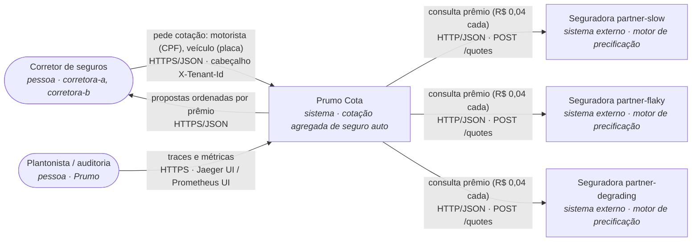
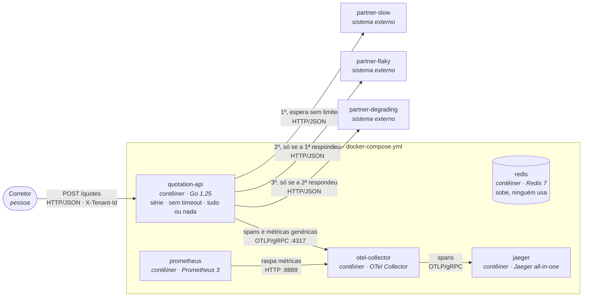
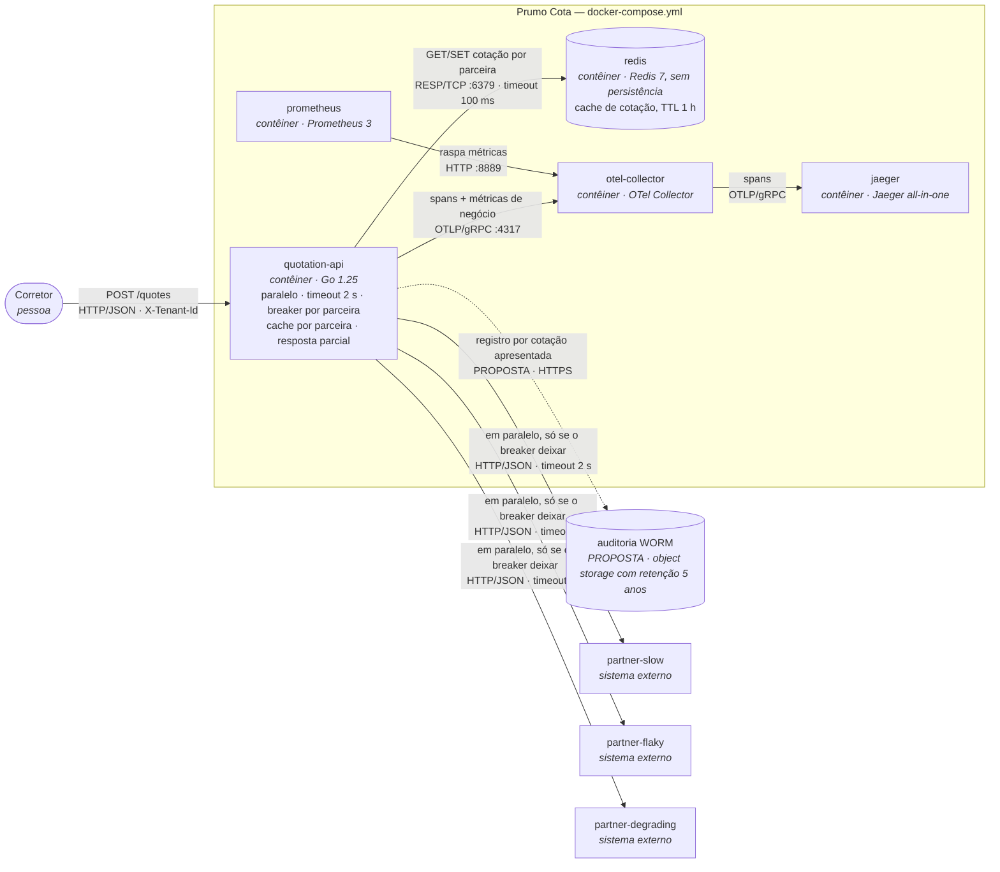
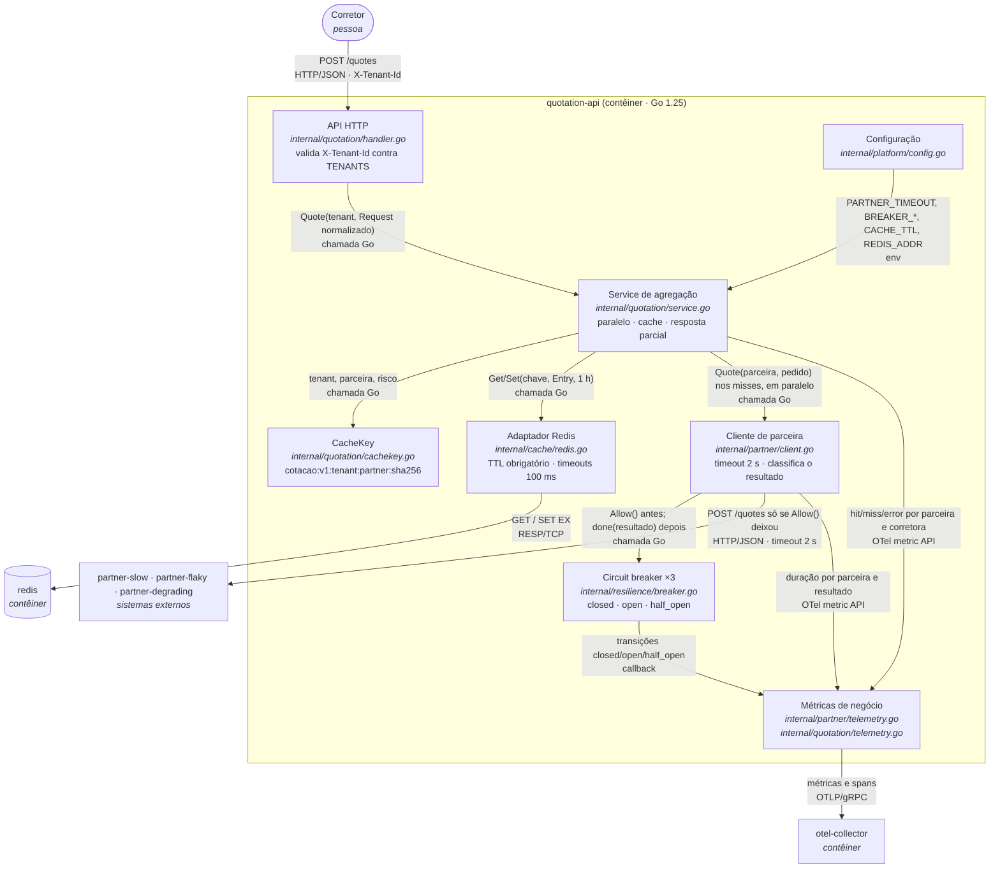

# SAD — Prumo Cota: proteção da fronteira com as seguradoras

Solution Architecture Document da plataforma de cotação de seguro auto da Prumo Tecnologia em Seguros,
depois da intervenção. O documento decide e justifica; o PoC deste repositório implementa a fatia
marcada como **implementada** e prova, com as medições de [`docs/evidencias/`](evidencias/), que ela
funciona. Tudo o que está marcado como **proposta** ainda não existe no código.

| | |
|---|---|
| Versão | 1.0 — 14/10/2026 |
| Base | fork de `devfullcycle/mba_arquitetura_desafio_cotacao_seguros`, commit `cbc3c1e` (o "antes") |
| Enunciado | [`docs/enunciado.md`](enunciado.md) |
| Leitores | CTO (aprova o gasto, seção 8) · plantonista (seções 6 e 7) · encarregado de dados e auditoria (seções 4.2, 4.3, 5.2 e 7) |

**Convenção de rastreabilidade.** Caminho entre crases é arquivo real deste repositório. Número
seguido de `[E:` + nome de arquivo + `]` foi medido por mim, e o arquivo com esse nome está em `docs/evidencias/`. Número seguido de
`[P-n]` é pressuposto da seção 1.4. Número seguido de `[Enunciado]` vem de `docs/enunciado.md`.

---

## 1. Introdução

### 1.1 Propósito

A Prumo Cota consulta três seguradoras e devolve as propostas da mais barata para a mais cara. Hoje
ela as consulta **em série**, **sem timeout** e **tudo ou nada**: medi, com a carga padrão, 60% de
sucesso e p95 de 8,01 s [E:antes-make-reproduce.txt], e 4,36 consultas pagas por cotação entregue
[E:antes-consultas-por-cotacao.txt]. Este SAD sustenta três decisões, cada uma com um número:

1. **circuit breaker com timeout, por parceira**: 2 s de espera máxima, abre com 6 falhas seguidas,
   10 s aberto, 2 sondas no meio aberto (seção 4.1);
2. **cache de cotação por parceira no Redis, com a corretora na chave**: TTL de 1 h (seção 4.2);
3. **fallback de resposta parcial**: a cotação sai com quem respondeu e diz quem faltou (seção 4.3).

E responde ao CTO se isso se paga (seção 8: sim, em menos de um mês, com ponto de equilíbrio em
2,5% de hit rate).

### 1.2 Escopo

**Dentro:** a `quotation-api` e a sua **fronteira** com as seguradoras (`internal/partner/client.go`,
`internal/quotation/service.go`), o cache, a instrumentação de negócio, a operação e a recuperação
dessa fatia, e o desenho (proposta) do registro de auditoria.

**Fora:** o motor de precificação das seguradoras (a Prumo não precifica), o CRM da corretora,
cadastro e cobrança de corretoras, interface de usuário, autenticação, retry com backoff, bulkhead,
rate limiting, fila e Kubernetes. Os quatro primeiros desta última lista aparecem como limites
conhecidos (4.6) e como evolução, não como código.

### 1.3 Restrições (impostas) × decisões (minhas)

| Restrições — vêm de fora, não se discutem aqui | Origem |
|---|---|
| Go 1.25, Docker Compose v2, Redis como cache, OpenTelemetry → Collector → Jaeger/Prometheus | Enunciado, "As regras não negociáveis" |
| Três parceiras com o comportamento de `cmd/partner-mock/` e os perfis do `docker-compose.yml`, que não se alteram | Enunciado |
| R$ 0,04 por consulta, 3 consultas por cotação, 120.000 cotações por dia útil, R$ 0,25 por cotação entregue, 22 dias úteis | Enunciado, "O cenário" |
| Seguradora honra o prêmio por até 24 h: teto comercial do reaproveitamento | Enunciado |
| SUSEP: toda cotação apresentada auditável (seguradora, prêmio, corretora, instante) por 5 anos, sem regravação | Enunciado |
| LGPD: corretora controladora, Prumo operadora; proibido uso cruzado; minimização e prazo de descarte | Enunciado |
| Prêmio é sempre de parceira ou de cache rastreável; nada calculado pela plataforma | Enunciado |
| A chave de cache contém a corretora | Enunciado |

| Decisões — minhas, defendidas neste documento | Onde |
|---|---|
| Timeout de 2 s, contando como falha no breaker | 4.1 |
| Breaker por parceira; 6 falhas seguidas; 10 s aberto; 2 sondas | 4.1 |
| Breaker próprio (`internal/resilience/breaker.go`) em vez de biblioteca | 4.1 e 5.1 |
| Cache por parceira, TTL de 1 h, chave `cotacao:v1:{tenant_id}:{partner}:{sha256(risco)}` | 4.2 |
| Fallback de resposta parcial, sem servir cotação vencida | 4.3 |
| Consulta às três parceiras em paralelo (bônus) | 4.4 |
| Nuvem pública em região no Brasil, auditoria em armazenamento WORM | 5.2 |

### 1.4 Pressupostos

Cada um com valor, origem e o que muda se for falso.

| ID | Pressuposto | Valor | Origem | Se for falso |
|---|---|---|---|---|
| P-1 | **Recotação** do mesmo risco pela **mesma corretora**, medida do instante da primeira compra: fração das cotações que repetem uma anterior em até 5 min / 15 min / 1 h / 24 h | 20% / 30% / **40%** / 50% | Estimativa minha a partir do Enunciado ("o corretor recota a mesma placa várias vezes na mesma conversa"); a repetição *entre* corretoras não conta, porque a chave isola por corretora | É o pressuposto que decide a seção 8. Com recotação em 1 h de 10% a economia cai a R$ 31.680/mês e ainda se paga; abaixo de **2,5%** o cache não se paga (8.4). Precisa ser medido em produção nas 2 primeiras semanas (alerta A-2, seção 6) |
| P-2 | Toda consulta enviada à seguradora é cobrada, inclusive a que volta 503 ou estoura o timeout | R$ 0,04 por chamada que sai | Leitura conservadora do Enunciado ("cobra por consulta ao motor") | Se a falha não for cobrada, o breaker economiza só tempo, não dinheiro; a conta do cache (8.1) não muda |
| P-3 | Cotação parcial (≥ 1 proposta) é faturável à corretora como cotação entregue | R$ 0,25 | Hipótese de produto, a validar com o comercial | Se não for, a resposta parcial deixa de proteger receita e vira só experiência do corretor; a decisão 4.3 continua de pé porque a alternativa (502) também não fatura |
| P-4 | Volume constante em 5 anos | 120.000 cotações/dia útil | Enunciado; crescimento não informado | Com crescimento, a auditoria (8.2) cresce na mesma proporção e a economia do cache também; o veredito não muda |
| P-5 | Pico de 12.000 cotações/h (dia útil de 10 h comerciais) | 12.000/h | Minha: 120.000 ÷ 10 h | Pico maior aumenta a concorrência na `partner-degrading` (4.6, limite L-1) e o custo por hora dos cenários da seção 7 |

---

## 2. Visão geral da arquitetura

### 2.1 Contexto (C4 nível 1) — igual antes e depois

A Prumo intermedeia: recebe o risco da corretora, compra o preço de três seguradoras que não
controla e devolve as propostas. Ela não precifica.



### 2.2 Contêineres — antes (C4 nível 2)

Os nomes são os serviços do `docker-compose.yml` no commit `cbc3c1e`.



### 2.3 Contêineres — depois (C4 nível 2)

Mesmos contêineres; o que muda é o que a `quotation-api` faz e o fato de ela falar com o Redis. O
armazenamento de auditoria é **proposta** (tracejado) e não existe no compose.



### 2.4 Delta

**Acrescenta**
- timeout de 2 s em toda chamada a parceira (`internal/partner/client.go`, `WithTimeout`);
- um circuit breaker por parceira (`internal/resilience/breaker.go`, ligado em `internal/partner/client.go`);
- cache de cotação por parceira no Redis (`internal/cache/redis.go`, chave em `internal/quotation/cachekey.go`);
- resposta parcial: campos `degraded`, `unavailable`, e por proposta `source`, `quoted_at`, `age_seconds` (`internal/quotation/request.go`);
- métricas e marcações de trace de negócio (`internal/partner/telemetry.go`, `internal/quotation/telemetry.go`);
- parâmetros `PARTNER_TIMEOUT`, `BREAKER_*`, `CACHE_TTL`, `REDIS_ADDR` (`internal/platform/config.go`, `docker-compose.yml`).

**Muda de lugar / de forma**
- a agregação deixa de ser série e passa a paralela (`internal/quotation/service.go`, `WithParallelCalls`);
- a falha de uma parceira deixa de ser falha da requisição: vira item de `unavailable`;
- o Redis passa de "sobe e ninguém usa" a dependência opcional (fail-open).

**Sai**
- a espera ilimitada (`http.Client.Timeout` zero) e o 502 por uma parceira só. O 502 continua existindo,
  com o mesmo corpo, apenas quando **nenhuma** parceira e **nenhum** cache tem proposta.

**A quem esta arquitetura serve.** Ao corretor, que tem o cliente na frente e passa a receber
resposta em até ~2 s mesmo com uma seguradora fora; ao CTO, porque cada recotação dentro da hora
deixa de comprar três consultas; à auditoria, porque toda proposta servida de cache aponta para o
`quote_id` da consulta que a originou e nunca atravessa a fronteira entre corretoras.

---

## 3. Requisitos

### 3.1 Funcionais

| ID | Requisito (frase testável) | Origem | Onde se prova |
|---|---|---|---|
| RF-01 | `POST /quotes` sem `X-Tenant-Id` responde 400 `X-Tenant-Id is required`; com corretora fora de `TENANTS` responde 403 `broker not enabled on this platform`; nos dois casos nenhuma parceira é chamada | contrato existente | `internal/quotation/handler_test.go` (`TestQuotesRejectsRequestWithoutTenant`, `TestQuotesRejectsUnknownBroker`) |
| RF-02 | A resposta 200 traz as propostas ordenadas por `premium_cents` crescente, **inclusive quando degradada** | contrato existente | `internal/quotation/resilience_test.go` (`TestDegradedAnswerIsVisibleInTheHTTPContract`) |
| RF-03 | Toda cotação apresentada (de parceira, de cache ou parcial) gera um registro de auditoria com seguradora, prêmio, `quote_id` de origem, corretora e instante, retido 5 anos sem regravação | SUSEP (Enunciado) | **proposta** (4.5); o PoC já devolve `quote_id`, `quoted_at` e `source`, que são os campos do registro |
| RF-04 | **(nova)** Uma proposta servida de cache traz `source: "cache"`, `age_seconds`, `quoted_at` e o **mesmo** `quote_id` e `premium_cents` da consulta que a originou | decisão 4.2 | `TestSecondQuoteComesFromCacheWithoutCallingThePartners` |
| RF-05 | **(nova)** Parceira com erro, timeout ou breaker aberto não derruba a cotação: resposta 200 com as demais, `degraded: true` e `unavailable: [{partner, reason}]`; sem nenhuma proposta, 502 `partner insurer unavailable` | decisão 4.3 | `TestPartnerDownBecomesAPartialAnswerThatSaysWhoIsMissing`, `TestNoPartnerAndNoCacheKeepsThe502` |
| RF-06 | **(nova)** Um risco cotado pela corretora A nunca é servido do cache à corretora B | LGPD (Enunciado), decisão 4.2 | `TestCacheKeyCarriesTheTenantAndHidesTheRisk`, `TestSecondQuoteComesFromCacheWithoutCallingThePartners` |
| RF-07 | **(nova)** Com o breaker de uma parceira aberto, a parceira **não é chamada**: nenhuma requisição HTTP sai e o motivo na resposta é `short_circuited` | decisão 4.1 | `internal/partner/breaker_test.go` (`TestBreakerOpensInsideTheBurstAndStopsCallingThePartner`) e [E:breaker-trace-curto-circuitado.json] |
| RF-08 | **(nova)** A plataforma recusa subir com `CACHE_TTL` acima de 24 h | teto comercial (Enunciado) | `internal/platform/config_test.go` (`TestCacheTTLCannotPassTheCommercialCeiling`) |

### 3.2 Não funcionais

"Carga padrão" é a do `make reproduce`: 10 requisições sequenciais de baseline e 200 com 50 em voo,
5 cotações distintas. "Hoje" foi medido por mim no commit `cbc3c1e`; "Depois" na entrega, mesma
máquina, mesma carga.

| ID | Requisito | Métrica | Hoje (medido) | Alvo | Depois (medido) | Como medir | Por que este número |
|---|---|---|---|---|---|---|---|
| RNF-01 | Latência da cotação sob carga | p95 do `POST /quotes`, s | **8,01 s** [E:antes-make-reproduce.txt] | **≤ 2,5 s** | 0,202 s [E:depois-make-reproduce.txt] | relatório do `loadgen`, fase `load`; e `histogram_quantile(0.95, sum by (le) (rate(http_server_request_duration_seconds_bucket{http_route="/quotes"}[1m])))` | Teto de espera por parceira (2 s, 4.1) + 0,5 s de folga para Redis, serialização e rede. Em paralelo, o pior caso é a parceira mais lenta, não a soma |
| RNF-02 | Latência da cotação sem carga | p95 do baseline sequencial, s | **2,03 s** [E:antes-make-reproduce.txt] | **≤ 2,0 s** | 1,68 s [E:depois-make-reproduce.txt] | relatório do `loadgen`, fase `baseline` | Uma cotação nunca espera mais que o timeout: a `partner-slow` responde em até 1,7 s (`docker-compose.yml`: 1500 ± 200 ms) |
| RNF-03 | Disponibilidade da cotação | % de `POST /quotes` com 200 e ≥ 1 proposta, sob carga padrão | **60%** (120/200) [E:antes-make-reproduce.txt] | **≥ 99%** | 100% (200/200) [E:depois-make-reproduce.txt] | relatório do `loadgen`; `sum by (http_response_status_code) (increase(http_server_request_duration_seconds_count{http_route="/quotes"}[15m]))` | Hoje a disponibilidade é o produto das três parceiras; com resposta parcial ela passa a depender de **ao menos uma** responder |
| RNF-04 | Custo de parceiro | consultas compradas por cotação entregue | **4,36** (545 / 125) [E:antes-consultas-por-cotacao.txt] | **≤ 1,8** em produção | 0,27 (57 / 210) [E:depois-contadores-execucao-padrao.txt] — propriedade da carga, não de produção | `sum(increase(http_client_request_duration_seconds_count[1d])) / sum(increase(http_server_request_duration_seconds_count{http_route="/quotes",http_response_status_code="200"}[1d]))` | 3 consultas × (1 − 40% de hit rate [P-1]) = 1,8. O "depois" medido é muito menor porque a carga repete 5 cotações (ver 8.1) |
| RNF-05 | Espera máxima por uma parceira | maior duração de chamada a parceira, s | **ilimitada**; 6,16 s observados na `partner-degrading` [E:antes-trace-serie-lento.json] | **≤ 2,0 s** | ≤ 2,0 s: nenhuma observação acima do bucket `le="2.0"` [E:breaker-contadores.txt] | `histogram_quantile(1, sum by (partner, le) (rate(quotation_partner_duration_seconds_bucket{outcome!="short_circuited"}[5m])))` | `PARTNER_TIMEOUT` (4.1) |
| RNF-06 | Isolamento entre corretoras | respostas com proposta cotada por outra corretora | não se aplica (sem cache) | **0** | 0 | `make test` (`TestSecondQuoteComesFromCacheWithoutCallingThePartners`, `TestCacheKeyCarriesTheTenantAndHidesTheRisk`) [E:make-test.txt] | LGPD: uso cruzado é incidente com notificação à ANPD |
| RNF-07 | Detecção de parceira fora | chamadas falhas até o breaker abrir; tempo até a primeira sonda | nunca abre (não há breaker) | **6 chamadas; 10 s** | abriu às 04:05:26 UTC depois de **exatamente 54 chamadas** à `partner-flaky` (contadas pelos spans `HTTP POST` no Jaeger), a 6ª falha da rajada 49–57; 5 episódios de meio aberto, 4 reaberturas (sequências 55, 56, 57 e 59, todas 503 em `docs/smoke-test-factibilidade.md`) e fechamento às 04:06:26; 30 requisições curto-circuitadas sem chamada HTTP [E:breaker-transicoes-log.txt], [E:breaker-contadores.txt] | `quotation_partner_circuit_transitions_total` e log `circuit breaker ... -> ...` | Parâmetros de 4.1 |

---

## 4. Detalhamento da arquitetura

### 4.1 Decisão 1 — Circuit breaker com timeout, por parceira

**Contexto.** As três parceiras falham de jeitos diferentes (Enunciado; `docker-compose.yml`): a
`partner-slow` nunca falha e leva 1500 ± 200 ms; a `partner-flaky` devolve 503 em 40% das chamadas,
com uma rajada de 9 falhas seguidas nas sequências 49 a 57 (`docs/smoke-test-factibilidade.md`); a
`partner-degrading` nunca falha, mas soma 300 ms por chamada simultânea acima de 5, até 6000 ms. No
"antes" a `partner-degrading` levou 6.160 ms numa única chamada [E:antes-trace-serie-lento.json] e a
API esperou, porque `http.Client.Timeout` era zero.

**Opções consideradas.**

| | Escopo | Veredito |
|---|---|---|
| A | Um breaker global para as três | Descartada: a `partner-flaky` sozinha abriria o circuito e derrubaria `partner-slow` e `partner-degrading`, que estão saudáveis. Num agregador de fornecedores independentes, o raio de falha tem que ser o fornecedor |
| B | Um breaker por par (parceira, corretora) | Descartada: a instabilidade é da seguradora, não da corretora. Com centenas de corretoras [Enunciado], cada uma pagaria sozinha as 6 falhas para descobrir que a parceira caiu: 6 × N consultas jogadas fora e N sondas a cada 10 s |
| **C** | **Um breaker por parceira** | **Escolhida** |

| | Disparo | Veredito |
|---|---|---|
| a | 3 falhas seguidas | Descartada: para uma parceira que falha 40% das vezes de forma independente, a chance de 3 seguidas a partir de um sucesso é 0,6 × 0,4³ = 3,8% por chamada: abre por ruído (13 aberturas em 210 requisições no `make smoke`, `docs/smoke-test-factibilidade.md`) |
| b | 5 falhas seguidas | Descartada: 0,6 × 0,4⁵ = 0,61% por chamada, cerca de 6 aberturas falsas por 1.000 chamadas; com a sequência real abre na sequência 42, numa rajada de 5 que é ruído normal da `partner-flaky`, não queda |
| c | % de falha numa janela (50% em 10, 60% em 20) | Descartada: 40% é a taxa **normal** da `partner-flaky`; uma janela de 10 passa de 50% por acaso com frequência (15 aberturas em 210 no `make smoke`). E janela por proporção precisa de volume mínimo, que madrugada de pouco tráfego não tem |
| **d** | **6 falhas seguidas** | **Escolhida**: 0,6 × 0,4⁶ = 0,25% por chamada (≈ 2,5 aberturas falsas por 1.000 chamadas). Na sequência determinística, nenhuma rajada antes da 49 chega a 6, e a de 9 chega a 6 na **sequência 54**. É ali que o breaker tem que abrir, e é ali que ele abre no teste e em execução |

**Escolha, com cada parâmetro** (defaults em `internal/platform/config.go`, valores explícitos no `docker-compose.yml`):

| Parâmetro | Variável | Valor | Por quê |
|---|---|---|---|
| Timeout da chamada | `PARTNER_TIMEOUT` | **2 s** | O maior tempo normal é o da `partner-slow`: 1500 + 200 = 1700 ms. 300 ms de folga evitam cortar a parceira lenta por jitter de rede. A `partner-degrading` passa de 2 s com 120 + 40 + 300 × (n − 5) > 2000, ou seja, a partir de **12 chamadas simultâneas**: é aí que a lentidão dela vira sinal |
| O timeout conta como falha? | — | **Sim** | Sem isso o breaker nunca abre para a `partner-degrading`, que não devolve erro: afunda. Provado em `TestTimeoutCountsAsFailureForTheBreaker` |
| O que fecha (zera) a contagem | — | 1 sucesso | A regra é "seguidas" |
| O que **não** conta | — | cancelamento pela corretora, 4xx (exceto 408 e 429), pedido inválido | Não dizem nada sobre a saúde da parceira (`breakerOutcome` em `internal/partner/client.go`) |
| Abertura | `BREAKER_CONSECUTIVE_FAILURES` | **6 seguidas** | Tabela acima. A "janela" é de contagem, sem componente de tempo, e por isso funciona igual com pouco e com muito tráfego |
| Tempo aberto | `BREAKER_OPEN_DURATION` | **10 s** | (1) Tem que ser ao menos 5× o timeout, para as chamadas que a própria API abandonou já terem saído da `partner-degrading` (ela conta como "em voo" até o cancelamento chegar) antes da sonda; (2) o custo de sondar uma parceira morta fica em no máximo 1 consulta a cada 10 s = 8.640 por dia = **R$ 345,60/dia por réplica**, contra 72.000 consultas/dia (120.000 × 60% de miss) que sairiam sem breaker; (3) uma parceira que volta é redescoberta em até 10 s, uma fração da conversa do corretor (minutos) |
| Meio aberto | `BREAKER_HALF_OPEN_MAX_CALLS` | **2 sondas; 2 sucessos fecham; 1 falha reabre** | Uma sonda só fecharia por sorte uma parceira em 40% de falha (chance de 60%); duas seguidas reduzem para 36%. As demais requisições durante o meio aberto são curto-circuitadas, para não despejar tráfego cheio numa parceira que ainda não provou nada |
| Estado aberto | — | **a chamada não sai** | `Breaker.Allow` devolve `ErrOpen` antes de qualquer I/O; não existe span `HTTP POST` e a consulta não é paga. Provado em `TestBreakerOpensInsideTheBurstAndStopsCallingThePartner` (a parceira recebe exatamente 54 chamadas) e no trace [E:breaker-trace-curto-circuitado.json] |

Os três estados estão nomeados em `internal/resilience/breaker.go`: `StateClosed`, `StateHalfOpen`,
`StateOpen`. A passagem aberto → meio aberto é preguiçosa (acontece quando alguém pergunta o estado
depois de vencido `OpenFor`: uma requisição ou a coleta da métrica a cada 10 s).

**Biblioteca: nenhuma; implementação própria de ~200 linhas.** Considerei `github.com/sony/gobreaker/v2`
(expõe os três estados, `ReadyToTrip`, `MaxRequests`, `OnStateChange`) e descartei por um motivo
verificável: ela lê `time.Now()` internamente, sem relógio injetável, e testar aberto → meio aberto
exigiria esperar `Timeout` de verdade, o "sleep calibrado" que o Enunciado não aceita. A nossa tem
`WithClock`, e os cinco testes de `internal/resilience/breaker_test.go` andam o relógio na mão. Também
precisávamos de um terceiro resultado além de sucesso/falha (`Ignored`, para cancelamento) e de
descartar resultados de chamadas admitidas num estado anterior (`generation`). `hystrix-go` foi
descartada por estar sem manutenção.

**Consequências.**
- Boas: a requisição curto-circuitada responde em microssegundos e não compra consulta; a lentidão da
  `partner-degrading` vira falha contável; cada parceira cai sozinha.
- Ruins: (1) **aberturas falsas custam tempo de parceira**: com a `partner-flaky` em 40% de falha
  permanente, cada abertura falsa dura em média 10 s ÷ 0,36 ≈ 28 s (cada meio aberto só fecha com duas
  sondas boas, chance de 0,6² = 36%); com ~2,5 aberturas falsas por 1.000 chamadas e ~2 chamadas/s a ela
  no pico [P-5, 60% de miss], são ~70 s fora a cada ~500 s, **cerca de 14% do tempo sem a `partner-flaky`**
  nas respostas de riscos novos. Aceito porque ela entregaria só 60% dessas respostas de qualquer
  forma, as outras duas parceiras e o cache seguem respondendo, e baixar o limiar para 5 dobraria as
  aberturas falsas; se a seguradora estabilizar, o número cai sozinho; (2) uma partner-degrading com 11 chamadas simultâneas responde em ~1,9 s e não é
  detectada: o timeout protege a corretora, mas não alivia a parceira; (3) o código do breaker é nosso
  para manter; (4) o estado vive na memória do processo (limite L-2).

### 4.2 Decisão 2 — Cache de cotação por parceira

**Contexto.** São 360.000 consultas por dia útil a R$ 0,04 (R$ 316.800/mês, 48% da receita bruta de
R$ 660.000) [Enunciado], e o corretor recota o mesmo risco dentro da conversa [P-1]. Cada acerto é uma
consulta que não se compra.

**Opções consideradas.**

| | Opção | Veredito |
|---|---|---|
| A | Cache da **cotação agregada** (uma entrada com as três propostas) | Descartada: economiza um pouco mais de leitura, mas vence inteira de uma vez e não existe quando uma parceira falhou no momento da compra; com a `partner-flaky` falhando 40%, 40% das entradas nasceriam incompletas ou não nasceriam |
| **B** | **Cache por parceira** | **Escolhida**: sobrevive a uma parceira fora (as outras duas propostas continuam em cache), e permite expurgar uma seguradora só |
| C | Cache em memória do processo | Descartada: não atravessa réplicas e some a cada deploy; o Redis é obrigatório [Enunciado] |

| | TTL | Hit rate sustentado [P-1] | Veredito |
|---|---|---|---|
| a | 300 s (o `valid_for_seconds` do mock, `cmd/partner-mock/config.go`) | 20% | Descartada: é o TTL técnico do mock, não o comercial [Enunciado], e corta a conversa do corretor no meio |
| b | 15 min | 30% | Descartada: deixa 10 pontos de hit rate (R$ 31.680/mês, 8.1) na mesa sem reduzir risco relevante, porque a seguradora honra o prêmio por 24 h |
| **c** | **1 h** | **40%** | **Escolhida**: cobre uma conversa de cotação inteira com folga; o dado pessoal pseudonimizado vive no máximo 1 h; um prêmio servido tem no máximo 1 h, 23 h dentro do prazo em que a seguradora honra |
| d | 24 h (o teto) | 50% | Descartada: +10 pontos de hit rate pagam R$ 31.680/mês, mas (1) mantêm a pegada de dado pessoal 24× maior, contra a minimização da LGPD; (2) servem, no limite, um prêmio que vence minutos depois de apresentado, e o contrato exige que a cotação exibida "ainda seja praticável na hora da venda" [Enunciado]; (3) mudança de tabela da seguradora levaria até um dia para aparecer (limite L-3) |

**Escolha.** Cache por parceira, TTL de **1 h** (`CACHE_TTL=1h`), com esta chave, montada em
`internal/quotation/cachekey.go`:

```
cotacao:v1:{tenant_id}:{partner}:{sha256(json([document, birth_year, plate, model, year, value_cents, coverage]))}
```

- `tenant_id` vem do cabeçalho `X-Tenant-Id` **já validado contra `TENANTS`** (`internal/quotation/handler.go`),
  nunca do corpo, que não tem a corretora. Está em claro para permitir o expurgo de uma corretora
  inteira (`SCAN 0 MATCH cotacao:v1:corretora-a:*`), que é o que a LGPD pede no fim do contrato.
- `partner` porque o cache é por parceira.
- o risco é o SHA-256 dos campos **já normalizados** por `Request.Normalize` (`internal/quotation/request.go`:
  placa em maiúscula, espaços cortados, cobertura padrão `comprehensive`), exatamente os que a
  parceira recebe. O array JSON evita que um separador dentro de um campo faça dois riscos colidirem.
  CPF e placa não aparecem em claro na chave. SHA-256 de um CPF é pseudonimização, não anonimização
  (é força-bruta-ável), então o Redis é tratado como base com dado pessoal: por isso o TTL curto e
  nenhuma persistência.
- `v1` é a versão do formato; trocar a versão é a invalidação em massa (6.3).

O valor guardado (`cache.Entry`, `internal/cache/redis.go`) é a proposta como a parceira devolveu,
com o `quote_id` original, e o instante da compra (`quoted_at`). Não há CPF nem placa no valor.

**Política completa.**

| Pergunta | Resposta | Onde |
|---|---|---|
| O que entra? | Só proposta comprada com sucesso. Falha, timeout e curto-circuito não são cacheados (sem cache negativo) | `quotePartner` em `internal/quotation/service.go` |
| Quando sai? | No TTL de 1 h, pelo próprio Redis (`SET ... EX`). Não existe escrita sem TTL: `Redis.Set` recusa `ttl <= 0` | `internal/cache/redis.go`; `TestNoWriteWithoutTTL` |
| Breaker aberto: a entrada ainda é servida? | **Sim, enquanto estiver dentro da 1 h**, porque ela é válida, não "vencida". A corretora fica sabendo pela proposta: `source: "cache"`, `age_seconds`, `quoted_at` | `TestCachedQuoteCoversAPartnerThatWentDown` |
| E a entrada vencida? | **Não é servida, nem com a parceira fora.** Não há "stale-if-error": guardar além de 1 h só para fallback reabriria a discussão de minimização (LGPD) e de prêmio praticável. A parceira sem proposta vai para `unavailable` (4.3) | — |
| O que invalida antes da hora? | (1) troca de `CacheKeyVersion` em `internal/quotation/cachekey.go` (deploy): tudo vira miss e o antigo expira sozinho em até 1 h; (2) expurgo manual por corretora ou por parceira com `SCAN`/`UNLINK` pelo padrão da chave (runbook 6.2, passo 6). Não existe invalidação por evento (limite L-3) | — |
| Como some o dado pessoal? | TTL de 1 h e Redis sem RDB/AOF (`docker-compose.yml`: `--save "" --appendonly no`): nenhuma cópia em disco. O prazo de descarte é a política de TTL, não a configuração do contêiner, e é garantido no código (`Set` sem TTL é recusado) | — |
| E se o Redis cair? | **Fail-open**: leitura com erro vira miss (`result="error"` na métrica), a cotação segue para a parceira. Timeouts no Redis (100 ms de leitura/escrita, 200 ms de conexão) para ele não virar um novo ponto de espera; depois de uma leitura com erro a gravação nem é tentada | `internal/cache/redis.go`; `TestRedisDownFallsBackToThePartners`; seção 7, cenário (a) |

**Consequências.**
- Boas: com 40% de recotação em 1 h, a conta de parceiro cai R$ 126.720/mês (8.1); a proposta de
  cache responde em microssegundos (trace de 402 µs com as três propostas de cache [E:depois-trace-servido-de-cache.json]).
- Ruins: (1) **duas requisições concorrentes para o mesmo risco frio compram a mesma consulta duas
  vezes**: na carga padrão, 5 riscos geraram 47 misses e 29 compras com sucesso na `partner-flaky`
  [E:depois-contadores-execucao-padrao.txt] (não há coalescência; limite L-1); (2) duas requisições da
  mesma corretora para o mesmo risco no mesmo minuto, uma de cache e uma de parceira, podem mostrar
  prêmios diferentes para o mesmo risco (não há garantia transacional entre cache e parceira; fora de
  escopo pelo Enunciado, citado aqui para o encarregado de auditoria: as duas são rastreáveis pelo
  `quote_id`); (3) a mesma placa cotada por duas corretoras é comprada duas vezes, de propósito.

### 4.3 Decisão 3 — Fallback: resposta parcial

**Contexto.** Hoje uma parceira falhando vira 502 e joga fora as respostas que já chegaram: no "antes",
85 consultas à `partner-slow` foram pagas e descartadas porque a `partner-flaky` falhou em seguida
[E:antes-consultas-por-cotacao.txt]; no trace com erro a requisição esperou 1,5 s pela `partner-slow`
e devolveu 502 [E:antes-trace-erro-flaky.json].

**Opções consideradas.**

| | Opção | Veredito |
|---|---|---|
| **A** | **Resposta parcial**: as parceiras que responderam (ou estavam em cache), mais a lista de quem faltou e por quê | **Escolhida** |
| B | Cotação anterior do cache, marcada e com idade, inclusive além do TTL | Descartada: só existe para quem cotou antes (a primeira cotação de um risco, que é a maioria, continuaria 502) e exige guardar dado pessoal além de 1 h. A parte boa dela já está na política de 4.2: proposta de cache dentro do TTL cobre a parceira fora, marcada com `source` e `age_seconds` |
| C | Recusa explícita com erro de negócio | Descartada: o produto é uma comparação; duas propostas de seguradoras reais servem ao corretor, que pode recotar a terceira depois. Recusar descarta 60% das cotações quando a `partner-flaky` está no ar normalmente |

**Escolha — o contrato** (`internal/quotation/request.go`, documentado também no `README.md`; valores ilustrativos):

```json
{
  "tenant_id": "corretora-a",
  "quotes": [
    {"partner": "partner-degrading", "quote_id": "partner-degrading-…", "premium_cents": 71234, "currency": "BRL",
     "coverage_cents": 5000000, "valid_for_seconds": 300,
     "source": "cache", "quoted_at": "2026-10-14T03:26:05Z", "age_seconds": 1},
    {"partner": "partner-slow", "quote_id": "partner-slow-…", "premium_cents": 152210, "currency": "BRL",
     "coverage_cents": 3000000, "valid_for_seconds": 300,
     "source": "partner", "quoted_at": "2026-10-14T03:26:06Z", "age_seconds": 0}
  ],
  "degraded": true,
  "unavailable": [{"partner": "partner-flaky", "reason": "error"}],
  "elapsed_ms": 192
}
```

- `degraded` (booleano, sempre presente) diz se faltou parceira; `unavailable` diz qual e o motivo:
  `error` (5xx/transporte), `timeout` (passou de 2 s) ou `short_circuited` (breaker aberto, nem foi
  chamada). A ordenação por prêmio continua (RF-02). O `X-Tenant-Id` volta no cabeçalho, como antes.
- Proposta de cache **não** é degradação: é operação normal, sinalizada por proposta (`source`, `age_seconds`).
- Nenhuma proposta (todas as parceiras sem resposta e nada em cache): **502 com o corpo de sempre**,
  `{"error":"partner insurer unavailable","partner":"<a primeira que falhou>"}` (`internal/quotation/handler.go`).
  Não há prêmio inventado em nenhum caminho.
- Os campos novos são **aditivos**: um cliente que lia `tenant_id`, `quotes[].partner`,
  `quotes[].premium_cents` e `elapsed_ms` continua funcionando.

**Auditoria.** A resposta parcial é cotação apresentada: gera o mesmo registro de RF-03, com as
propostas apresentadas e a lista `unavailable`, para que se possa provar à SUSEP **o que** foi mostrado
e **por que** faltou uma seguradora.

**Consequências.**
- Boas: disponibilidade de 60% para 100% sob carga padrão [E:depois-make-reproduce.txt]; nenhuma
  consulta paga é jogada fora por causa de outra parceira.
- Ruins: (1) a proposta mais barata pode ser justamente a que faltou: o corretor vê "a mais barata
  entre as que responderam", e o contrato tem que deixar isso claro (por isso `unavailable` é
  obrigatório e não um log); (2) a corretora precisa tratar os campos novos para exibir o aviso, senão
  apresenta uma comparação incompleta como completa; (3) o faturamento de cotação parcial é hipótese
  [P-3].

### 4.4 Decisão 4 (bônus) — Consulta às parceiras em paralelo

**Contexto.** Em série, a latência é a soma: 1,7 + 0,2 + 0,16 s em repouso e até 1,7 + 0,2 + 6 s sob
carga (trace de 7,9 s no "antes" [E:antes-trace-serie-lento.json]).

**Opções.** (A) manter a série e só pôr timeout: pior caso 3 × 2 s = 6 s, acima do RNF-01;
(B) **paralelo** (escolhida): pior caso = 2 s, o timeout; (C) paralelo com prazo global por cotação
menor que o timeout por parceira: descartada no PoC por adicionar um segundo número sem medição que o
defenda.

**Consequências.** Boa: p95 do baseline de 2,03 s para 1,68 s, e a cotação passa a ser limitada pela
parceira mais lenta (RNF-02). Ruim: a `partner-degrading` passa a receber as chamadas no mesmo instante
em que a `partner-slow`, em vez de 1,5 s depois; sob carga com cache frio isso aumenta a concorrência
nela (o que a seção 7, cenário (a), mede). Os testes de série que vieram com o repositório
(`TestQuoteCallsThePartnersSerially`) continuam valendo para o `Service` sem opções: o paralelo é
`WithParallelCalls`, ligado em `cmd/quotation-api/main.go`.

### 4.5 Auditoria (proposta)

Não implementada (fora de escopo pelo Enunciado). Desenho: a cada resposta 200, um evento por
**cotação apresentada** com `tenant_id`, instante, e por proposta `partner`, `quote_id`, `premium_cents`,
`source`, `quoted_at`, mais `unavailable`. Sem CPF e sem placa: o vínculo com o consumidor é o hash
do risco da chave de cache, e o dado pessoal fica com a corretora, que é a controladora. Gravação
síncrona antes da resposta, em object storage com retenção WORM de 5 anos (5.2). Custo na seção 8.2.

### 4.6 Limites conhecidos (não resolvidos por esta entrega)

| ID | Limite | Gatilho que o expõe | Efeito na corretora | Evolução (não implementada) |
|---|---|---|---|---|
| L-1 | **Sem limite de chamadas simultâneas por parceira** (sem bulkhead nem coalescência de misses) | Cache frio (deploy, Redis perdido, seção 7a), muitas cotações distintas ao mesmo tempo, ou várias requisições para o mesmo risco frio | A `partner-degrading` passa de 5 em voo e afunda; com ≥ 12 em voo estoura 2 s, o breaker abre e a corretora recebe resposta parcial sem ela, esperando até 2 s. Na carga padrão, 29 compras na `partner-flaky` para 5 riscos [E:depois-contadores-execucao-padrao.txt] | bulkhead de 5 chamadas por parceira; single-flight por chave |
| L-2 | **O breaker vive na memória do processo** e não atravessa réplicas | Mais de uma réplica da `quotation-api`, ou reinício do processo | Com N réplicas, cada uma paga sozinha as 6 falhas e as sondas (N × R$ 345,60/dia no pior caso); a mesma corretora pode ver a `partner-flaky` numa resposta e `short_circuited` na seguinte, conforme a réplica que atende. Reinício volta a fechado e repaga 6 falhas | estado compartilhado (no próprio Redis) ou um sidecar/proxy de saída único |
| L-3 | **O TTL é a única invalidação automática** | Seguradora muda tabela de preço, ou corretora renegocia condições comerciais, no meio da hora | Até 1 h servindo o prêmio da tabela antiga (ainda honrado, dentro das 24 h, mas não o novo preço). O expurgo manual (6.2) é por padrão de chave e manual | invalidação por evento da seguradora; TTL por parceira |
| L-4 | **Uma corretora pode consumir a capacidade das outras** | Uma corretora dispara uma recotação em lote de milhares de placas distintas | Todas as consultas são misses, a concorrência na `partner-degrading` sobe, o breaker dela abre e **todas** as corretoras passam a receber resposta parcial; o Redis também não tem cota por corretora | rate limiting por `X-Tenant-Id`; breaker/bulkhead com cota por corretora |

### 4.7 Componentes da fatia implementada (C4 nível 3)



---

## 5. Implementação

### 5.1 Como se constrói

| Mecanismo | Arquivo real | Ligado em | Testado em (determinístico, sem sleep) |
|---|---|---|---|
| Timeout de 2 s | `internal/partner/client.go` (`WithTimeout` → `http.Client.Timeout`) | `cmd/quotation-api/main.go` | `internal/partner/breaker_test.go`: `TestTimeoutCountsAsFailureForTheBreaker` (parceira que nunca responde; o resultado não depende de tempo, só de o prazo existir) |
| Circuit breaker | `internal/resilience/breaker.go` (estados, relógio injetável); um por parceira em `internal/partner/client.go` (`WithBreakers`) | `cmd/quotation-api/main.go` | `internal/resilience/breaker_test.go` (os três estados e as transições, com relógio de mentira); `internal/partner/breaker_test.go`: `TestBreakerOpensInsideTheBurstAndStopsCallingThePartner` reproduz num `httptest` as 60 primeiras respostas da `partner-flaky` documentadas em `docs/smoke-test-factibilidade.md` e prova que abre na chamada 54 e que a parceira não recebe a 55ª até a sonda — o mesmo molde de `cmd/partner-mock/feasibility_test.go` |
| Cache | `internal/cache/redis.go` (`github.com/redis/go-redis/v9` v9.7.3); chave em `internal/quotation/cachekey.go`; uso em `internal/quotation/service.go` (`WithCache`) | `cmd/quotation-api/main.go` | `internal/cache/redis_test.go` (`github.com/alicebob/miniredis/v2`, TTL com `FastForward`); `internal/quotation/resilience_test.go` (cache em memória com relógio do teste) |
| Fallback | `internal/quotation/service.go` (`WithPartialResponse`), contrato em `internal/quotation/request.go` | `cmd/quotation-api/main.go` | `internal/quotation/resilience_test.go` (5 testes, incluindo o contrato HTTP e o Redis fora) |
| Paralelo | `internal/quotation/service.go` (`WithParallelCalls`) | `cmd/quotation-api/main.go` | — (os testes de série legados seguem cobrindo o `Service` sem opções) |
| Métricas e traces | `internal/partner/telemetry.go`, `internal/quotation/telemetry.go`, atributos em `client.go` e `service.go` | SDK já iniciado em `internal/platform/telemetry.go` (inalterado) | evidências de execução (seção 6.1) |
| Parâmetros | `internal/platform/config.go` | `docker-compose.yml` | `internal/platform/config_test.go` (`TestResilienceDefaultsAreTheSADNumbers` prende os números deste SAD ao código) |

**Compatibilidade.** `partner.NewClient()` e `quotation.NewService(partners, quoter)` sem opções se
comportam como o starter, e por isso os testes que vieram com o repositório continuam verdes sem
alteração (`internal/quotation/service_test.go` fixa série e tudo-ou-nada). A política desta
arquitetura é ligada por opções em `cmd/quotation-api/main.go`. Saída do `make test` em [E:make-test.txt].

### 5.2 Decisão 5 — Onde roda

**Contexto.** Quem decide é o compliance, não a preferência: (1) dado pessoal de consumidor sob
contrato de operadora com a corretora (LGPD), que proíbe uso cruzado e exige descarte; (2) registro de
cotação retido por 5 anos **sem regravação** (SUSEP) [Enunciado]; (3) o custo da dependência externa
(R$ 316.800/mês) é 100× o de infraestrutura (8.2), então a hospedagem não muda o veredito financeiro,
mas muda o risco regulatório.

| | Opção | Veredito |
|---|---|---|
| A | On-premise (data center próprio ou colocation) | Descartada: imutabilidade de 5 anos exige storage WORM certificado e um **segundo site** para DR (seção 7c), capex de hardware e contrato antes da primeira cotação, e uma equipe de infraestrutura que a Prumo não tem (8.3). Não resolve nada que a opção C não resolva |
| B | Híbrido: computação em nuvem, auditoria on-premise | Descartada: põe a gravação síncrona da auditoria (4.5) atrás de um link WAN, de modo que a latência e a disponibilidade da cotação passam a depender desse link, e mantém o custo do segundo site |
| C' | Nuvem pública em região fora do Brasil | Descartada: CPF e placa sairiam do país, o que é transferência internacional (LGPD, capítulo V) e exigiria cláusula específica no contrato com cada corretora controladora |
| **C** | **Nuvem pública em região no Brasil (São Paulo), duas zonas de disponibilidade; auditoria em object storage com bloqueio de objeto (WORM) em modo compliance, réplica em uma segunda região** | **Escolhida** |

**Consequências.** Boas: residência no Brasil sem negociação por corretora; imutabilidade como
configuração de bucket, não como processo; DR de região disponível sem segundo data center. Ruins:
(1) a segunda região de nuvem com dados no Brasil é limitada, então a réplica da auditoria (7c) pode
ter que ir para outra região da mesma jurisdição de outro provedor, ou exigir aditivo contratual;
(2) dependência de um provedor (lock-in no recurso de WORM); (3) preço em dólar (8.2). Custo de
infraestrutura acrescentada: R$ 1.000/mês no ano 1 (8.2).

**Ambiente deste PoC**: local, com Docker Compose (`docker-compose.yml`), sem custo; não há
infraestrutura de nuvem provisionada neste repositório.

---

## 6. Operação e gestão de mudanças

### 6.1 O que se olha

As métricas são emitidas pelo código e chegam ao Prometheus via Collector (`deploy/otel/collector.yaml`).
Nenhuma tem CPF, placa ou `quote_id` em atributo; o único identificador é `tenant_id`.

| Métrica (nome no Prometheus) | Tipo | Atributos | Emitida em | Pergunta que responde |
|---|---|---|---|---|
| `quotation_partner_circuit_state` | gauge | `partner` | `internal/partner/telemetry.go` | Em que estado está o breaker de cada parceira? 0 fechado, 1 meio aberto, 2 aberto |
| `quotation_partner_circuit_transitions_total` | contador | `partner`, `from`, `to` | `internal/partner/telemetry.go` | Quantas vezes abriu/fechou, e entre quais estados? |
| `quotation_cache_requests_total` | contador | `result` (`hit`/`miss`/`error`), `partner`, `tenant_id` | `internal/quotation/telemetry.go` | Qual o hit rate (a premissa da seção 8)? O Redis está respondendo? |
| `quotation_partner_duration_seconds` | histograma | `partner`, `outcome` (`success`, `error`, `timeout`, `short_circuited`, `canceled`, `rejected`) | `internal/partner/telemetry.go` | Latência por parceira com significado de domínio: separa o lento do curto-circuitado |
| `http_server_request_duration_seconds`, `http_client_request_duration_seconds` | histograma | genéricos, já vinham | `internal/platform/telemetry.go` | p95 da ponta (RNF-01) e consultas efetivamente enviadas (RNF-04) |

Marcações de trace (spans `quotation.partner`, um por parceira, filhos de `POST /quotes`):
`quotation.circuit.short_circuited=true` + evento `circuit breaker open: partner not called` na
requisição curto-circuitada; `quotation.cache.hit=true`, `quotation.source=cache`,
`quotation.cache.age_seconds` na proposta servida de cache. No span raiz: `quotation.degraded`,
`quotation.cache_hits`, `quotation.quotes`, `quotation.tenant_id`. Busca no Jaeger: Tags
`quotation.circuit.short_circuited=true` ou `quotation.cache_hits=3`.

**Quem olha:** o plantonista olha os quatro alertas abaixo e o runbook; o financeiro olha o hit rate
semanal (premissa P-1); a auditoria olha o trace de uma cotação específica quando precisa reconstruir
de onde veio uma proposta. Nada mais é instrumentado: um span por parceira por cotação, sem span por
função.

### 6.2 Alertas

As regras são **proposta** (o compose não tem Alertmanager); as consultas rodam hoje no Prometheus.

| ID | Sinal | Consulta e limiar | Ação |
|---|---|---|---|
| A-1 | Breaker sem fechar há 10 min | `min_over_time(quotation_partner_circuit_state[10m]) >= 1` | Página o plantonista: **runbook 6.3** |
| A-2 | Hit rate abaixo da metade do planejado | `sum(rate(quotation_cache_requests_total{result="hit"}[1h])) / sum(rate(quotation_cache_requests_total[1h])) < 0.20` por 2 h em horário comercial | Ticket (não página) para arquitetura + financeiro: ou o Redis está perdendo dados (ver A-3), ou a premissa P-1 está errada e a seção 8 precisa ser refeita. Não mexer no TTL sem passar por 6.4 |
| A-3 | Redis indisponível | `sum(rate(quotation_cache_requests_total{result="error"}[5m])) / sum(rate(quotation_cache_requests_total[5m])) > 0.05` por 5 min | Página: o cache está em fail-open, custo +R$ 576/h e risco de L-1 na `partner-degrading` (seção 7a). Restaurar o Redis; não reiniciar a `quotation-api` (o breaker perderia o estado) |
| A-4 | Parceira perto do teto de espera | `histogram_quantile(0.95, sum by (partner, le) (rate(quotation_partner_duration_seconds_bucket{outcome!="short_circuited"}[5m]))) > 1.8` por 10 min | Ticket: a parceira está a 200 ms do timeout; se for a `partner-slow`, abrir chamado com a seguradora antes que o timeout comece a cortá-la (o que zeraria as propostas dela) |

### 6.3 Runbook — "o breaker da `partner-degrading` está aberto há 10 minutos" (A-1)

1. **Confirme o sintoma** (2 min). No Prometheus: `quotation_partner_circuit_state{partner="partner-degrading"}`
   em 2 por 10 min, ou alternando 2 → 1 → 2 (sondas falhando). Em
   `sum by (to) (increase(quotation_partner_circuit_transitions_total{partner="partner-degrading"}[10m]))`
   deve haver `to="open"` e nenhum `to="closed"`.
2. **Meça o impacto** (2 min). As cotações continuam saindo, com `unavailable: [{"partner":"partner-degrading","reason":"short_circuited"}]`.
   Confirme que as outras duas parceiras estão fechadas e que o p95 da ponta segue abaixo de 2,5 s (RNF-01).
   Se as **três** estiverem abertas, as cotações viraram 502: pule para o passo 7 imediatamente.
3. **Ache a causa entre as duas possíveis** (5 min).
   `sum by (outcome) (rate(quotation_partner_duration_seconds_count{partner="partner-degrading"}[5m]))`:
   - predomina `timeout`: a parceira está **afundando** (concorrência ≥ 12, seção 4.1). Verifique se
     houve perda de cache (A-3 disparado? `result="error"`) ou uma corretora em lote (`sum by (tenant_id) (rate(quotation_cache_requests_total{result="miss"}[5m]))`): é o limite L-1 ou L-4, não a seguradora;
   - predomina `error`: a seguradora está **fora** (manutenção, incidente dela).
4. **Verifique a parceira por fora da API** (1 min). `curl -s -o /dev/null -w '%{http_code} %{time_total}\n' -X POST http://partner-degrading:8080/quotes -d '{}'`
   e os cabeçalhos `X-Partner-Inflight` (em quantas chamadas simultâneas ela está).
5. **Aja.** Se a causa é carga nossa (L-1/L-4): restabeleça o Redis (runbook de A-3) ou contate a
   corretora do lote; o breaker volta a fechar sozinho em até 10 s depois que a concorrência cair. Se
   a causa é a seguradora: abra chamado com ela e registre o horário de início para o relatório de SLA.
6. **Expurgo, só se a seguradora informar que os preços dos últimos 60 min estão errados**:
   `redis-cli --scan --pattern 'cotacao:v1:*:partner-degrading:*' | xargs -r redis-cli unlink`
   (entradas de outras parceiras e corretoras não são tocadas, por causa da chave de 4.2).
7. **Escalone** para a liderança de engenharia se: as três parceiras estão abertas (cotação parou);
   ou o breaker segue aberto após 60 min (a partir daí, informe as corretoras que a seguradora está
   fora, porque o corretor está vendendo sem ela); ou A-3 também está disparado há mais de 30 min.

**O que o plantonista NÃO faz:** não reinicia a `quotation-api` para "fechar o breaker" (ele reabre em
6 falhas, e cada réplica repaga as falhas, L-2); não aumenta `PARTNER_TIMEOUT` para "a parceira caber"
(empurra a espera de volta para a corretora e alimenta o afundamento); não esvazia o Redis inteiro
(perde 40% de hit rate de todas as parceiras para resolver uma).

### 6.4 Gestão de mudanças — o TTL do cache

O TTL é parâmetro de **negócio**: mexe em custo (8.1), em risco de prêmio desatualizado e em pegada de
dado pessoal.

| Pergunta | Resposta |
|---|---|
| Quem aprova | Produto (prêmio praticável na venda) **e** financeiro (seção 8) **e** encarregado de dados (prazo de descarte). Os três; arquitetura redige a proposta com o hit rate esperado pela P-1 |
| Como chega em produção | PR alterando `CACHE_TTL` (no `docker-compose.yml` aqui; no manifesto de deploy em produção) **e** este SAD (4.2 e 8.1) no mesmo PR. O código recusa valor acima de 24 h (`internal/platform/config.go`, RF-08) |
| Como se reverte | Revert do PR. Ao **reduzir** o TTL, entradas já gravadas mantêm o TTL antigo; se a redução for por risco de preço ou LGPD, acompanhe com a troca de `CacheKeyVersion` (`internal/quotation/cachekey.go`), que torna tudo miss na hora |
| Como se mede se melhorou | Duas semanas antes e depois: hit rate (`quotation_cache_requests_total`, A-2), consultas por cotação entregue (RNF-04) e reclamações de prêmio não honrado. A mudança só fica se o hit rate subir o que a P-1 previa |

Os mesmos passos valem para os parâmetros do breaker (`BREAKER_*`), aprovados por engenharia, com o
`make smoke` e `internal/partner/breaker_test.go` como verificação de que o novo limiar ainda abre
na rajada documentada.

---

## 7. Recuperação de desastres

### 7.1 RTO e RPO por classe de dado

| Classe de dado | Onde vive | RPO | RTO | Por quê |
|---|---|---|---|---|
| Cotação em cache | `redis`, sem persistência | **não se recupera** (descartável) | **15 min** para um Redis vazio | Reconstruída comprando de novo; perder o cache custa dinheiro e concorrência, não dado. Persistir seria guardar dado pessoal em disco sem necessidade |
| Estado do breaker | memória da `quotation-api` | **não se recupera** | imediato (nasce fechado) | Reaprende em ≤ 6 falhas por parceira |
| Registro de auditoria (proposta) | object storage WORM | **0** na região (gravado antes da resposta, multi-zona); **≤ 15 min** entre regiões (réplica assíncrona) | **24 h** para consulta | Perder registro é infração regulatória; a consulta à auditoria não é de tempo real |
| Configuração (TTL, limiares, código) | git | **0** | **15 min** (redeploy) | Tudo é texto versionado neste repositório |
| Telemetria | Jaeger/Prometheus | **1 h** aceita | **1 h** | Serve à operação, não à corretora nem ao regulador; o Prometheus daqui já retém só 1 h (`docker-compose.yml`) |

### 7.2 Cenário (a) — o Redis inteiro se perde

**O que a corretora vê:** as cotações continuam saindo (fail-open, `TestRedisDownFallsBackToThePartners`),
mas toda cotação volta a comprar as três consultas e a esperar a parceira mais lenta (~1,7 s, em vez
de µs para quem recotava). **Degrada:** latência e custo. **Não para:** nada, enquanto ao menos uma
parceira responder.

**Qual efeito chega primeiro: a concorrência, em segundos.** Com 40% de hit rate, perder o cache
multiplica as chamadas às parceiras por 1 / (1 − 0,4) = **1,67×**, de uma vez. No pico de 12.000
cotações/h [P-5] cada parceira passa de ~2 para ~3,3 chamadas por segundo; como cada chamada à
`partner-degrading` dura ≥ 120 ms e a `partner-slow` segura a requisição 1,7 s, rajadas de chegada
passam de 5 simultâneas com facilidade. Medi o efeito com a carga padrão e o Redis parado
[E:redis-fora-make-load.txt], [E:redis-fora-estado-breaker.png]: a carga começou às 04:10:49 e
**2 s depois** (04:10:51) o breaker da `partner-degrading` já estava aberto, depois de 53 chamadas
estourarem os 2 s; 136 requisições seguintes saíram sem ela (`short_circuited`). As cotações
seguiram 200/200, com p95 de 2,21 s sob carga (contra 0,202 s com o Redis no ar) e 1,90 s sem carga
(contra 1,68 s). **O que a corretora vê primeiro, então, é a `partner-degrading` sumindo das
respostas em segundos**, não a conta. O custo chega depois e linearmente:
**+R$ 576 por hora comercial** (R$ 14.400/dia × 40% ÷ 10 h) e **+R$ 5.760 por dia útil**.

**O que a implementação corrigiu neste cenário.** A primeira versão tentava gravar no Redis depois
de uma leitura que já tinha falhado, e cada cotação pagava o `DialTimeout` de 200 ms duas vezes: o
baseline sem carga foi a p95 de 2,10 s, acima do RNF-02 [E:redis-fora-1-antes-da-correcao.txt]. Agora
a gravação nem é tentada depois de uma leitura com erro (`internal/quotation/service.go`, coberto por
`TestRedisDownFallsBackToThePartners`), e o baseline ficou em 1,90 s. Os ~0,2 s restantes são um
`DialTimeout` por cotação; um breaker também para o Redis os eliminaria (proposta).

**Caminho de volta:** subir um Redis vazio (RTO 15 min); nada a restaurar. O hit rate volta ao
patamar em 1 h (um TTL). Durante esse aquecimento os misses de um mesmo risco podem se repetir em
paralelo (L-1). Alerta: A-3.

### 7.3 Cenário (b) — uma parceira fora por seis horas

**O que a corretora vê:** respostas 200 com duas propostas e
`unavailable: [{"partner":"…","reason":"short_circuited"}]`, mais as propostas daquela parceira que
ainda estiverem em cache (até 1 h de idade, `source: "cache"`). **Degrada:** a comparação fica com duas
seguradoras para riscos novos. **Não para:** a cotação.

**Custo do modo degradado (6 h, pico de 12.000 cotações/h):**
- com breaker: 6 falhas para abrir + no máximo 1 sonda a cada 10 s = **2.160 consultas = R$ 86,40**
  por réplica [P-2]; a corretora não espera nada pela parceira fora;
- sem breaker (o "antes" com resposta parcial): 12.000 × 6 h × 60% de miss = 43.200 consultas falhas =
  **R$ 1.728,00** jogados fora, e cada uma esperando até 2 s se a parceira "pendurar" em vez de recusar;
- receita: se a cotação parcial for faturável [P-3], nenhuma perda; se não for, até 12.000 × 6 × 60% × R$ 0,25 = R$ 10.800.

**Caminho de volta:** automático. Quando a seguradora volta, a próxima sonda (≤ 10 s) passa, a
segunda fecha o circuito, e o cache dela se reconstrói em 1 h. O plantonista só registra o incidente
(runbook 6.3, passos 5 e 7).

### 7.4 Cenário (c) — perda do site (região)

**O que a corretora vê:** nada responde; `POST /quotes` falha por conexão. **Para:** tudo. Não há
resposta parcial possível, porque a `quotation-api` e o Redis estão na mesma região. **Custo:** receita
de 12.000 cotações/h × R$ 0,25 = **R$ 3.000 por hora comercial** sem faturar, mais a reputação junto às
corretoras.

**Caminho de volta (RTO 4 h, proposta):** subir `quotation-api`, Redis e Collector na região
secundária a partir do mesmo `docker-compose.yml`/manifesto versionado (o código e a configuração são
RPO 0, 7.1), apontar o DNS. O cache começa vazio (custo do cenário (a) por 1 h); o breaker nasce
fechado; a auditoria continua íntegra na réplica (RPO ≤ 15 min entre regiões). O que **não** se
recupera e não precisa: cache e telemetria da janela do desastre. A promessa comercial de
disponibilidade deve ser escrita sabendo disso: 4 h de RTO de região num SLA mensal de 99,5%
(3,6 h/mês) consomem o mês inteiro.

---

## 8. Tecnologias, custos e pessoal

Unidades: mês = 22 dias úteis; R$ 0,04 por consulta; 3 consultas por cotação; 120.000 cotações/dia
útil; R$ 0,25 por cotação entregue (receita de R$ 660.000/mês) [Enunciado]. Preços de infraestrutura e
de pessoal são **valores assumidos** (referência de mercado, a confirmar na contratação), e por isso a
seção termina com a sensibilidade.

### 8.1 Conta de parceiro por hit rate

O hit rate vem da **recotação** [P-1], não do gráfico do PoC: a carga padrão repete 5 cotações em
210 requisições, e o hit rate medido nela (91% [E:depois-contadores-execucao-padrao.txt]) é propriedade
da carga. Hit rate = fração das cotações que repetem, dentro do TTL, um risco já comprado pela mesma
corretora.

| Cenário | TTL | Hit rate [P-1] | Consultas/mês | Custo/mês | Economia vs hoje | % da receita |
|---|---|---|---|---|---|---|
| **Hoje** (sem cache) | — | 0% | 7.920.000 | R$ 316.800 | — | 48,0% |
| TTL técnico do mock | 5 min | 20% | 6.336.000 | R$ 253.440 | R$ 63.360 | 38,4% |
| TTL curto | 15 min | 30% | 5.544.000 | R$ 221.760 | R$ 95.040 | 33,6% |
| **Escolhido** | **1 h** | **40%** | **4.752.000** | **R$ 190.080** | **R$ 126.720** | **28,8%** |
| Teto comercial (não escolhido, 4.2) | 24 h | 50% | 3.960.000 | R$ 158.400 | R$ 158.400 | 24,0% |

Aproximações declaradas: (1) a `partner-flaky` só grava entrada quando responde (60%), então o hit
rate dela é menor que o das outras; (2) misses concorrentes para o mesmo risco compram em dobro (L-1);
(3) as sondas do breaker (≤ R$ 345,60/dia por réplica com uma parceira fora o dia inteiro) não estão
na tabela. As três reduzem a economia em poucos pontos e não mudam o veredito (8.4).

### 8.2 Infraestrutura acrescentada

| Item | Dimensionamento | Valor assumido | Ano 1 | Ano 5 |
|---|---|---|---|---|
| Redis gerenciado | 2 nós pequenos (primário + réplica em outra zona). Chaves vivas no pico: 12.000 cotações/h × 3 parceiras × 1 h = 36.000 × ~0,5 KB ≈ 18 MB; o nó menor do provedor sobra | R$ 250/nó/mês | R$ 6.000 | R$ 6.000 |
| Retenção de telemetria acrescentada | 3 spans a mais por cotação (360.000/dia útil) com amostragem de 10% e 7 dias de retenção; ~3.000 séries de métrica (`tenant_id` × parceira × resultado, com centenas de corretoras) | R$ 300/mês | R$ 3.600 | R$ 3.600 |
| Auditoria WORM, armazenamento (proposta 4.5) | ver abaixo | R$ 0,15/GB-mês, × 2 (réplica entre regiões) | R$ 62 | R$ 518 |
| Auditoria, gravações | lotes de 1 min por réplica: ~40.000 objetos/mês | R$ 0,04 por 1.000 | R$ 19 | R$ 19 |
| **Total** | | | **≈ R$ 9.700/ano (R$ 810/mês)** | **≈ R$ 10.100/ano** |

**Auditoria, pela unidade certa.** O registro é por **cotação apresentada**, não por consulta
comprada: uma proposta servida de cache continua sendo cotação apresentada a um consumidor. São
2.640.000 cotações/mês (120.000 × 22), ~1 KB comprimido cada (3 propostas + `unavailable` + metadados,
sem CPF) = **2,64 GB/mês**, acumulando por 5 anos:

- ano 1: Σ (2,64 GB × m) para m = 1..12 = 205,9 GB-mês × R$ 0,15 × 2 = **R$ 62**; acervo no fim do ano: 31,7 GB;
- ano 5: Σ (2,64 GB × m) para m = 49..60 = 1.726,6 GB-mês × R$ 0,15 × 2 = **R$ 518**; acervo no fim do ano: 158,4 GB (5 anos inteiros; daí em diante a regra de ciclo de vida apaga o mês 1 a cada mês novo).

Quem dimensionasse pelas consultas que sobraram depois do cache (60%) chegaria a 1,58 GB/mês e erraria
para baixo por 1 / (1 − 0,4) = **1,67×**: R$ 311 no ano 5 em vez de R$ 518. O valor é pequeno diante
da economia, mas a unidade errada é a mesma que subdimensionaria a capacidade de busca para a SUSEP.

### 8.3 Pessoal

| Fase | Papéis | Esforço | Custo mensal assumido (encargos inclusos) | Total |
|---|---|---|---|---|
| Construção (3 semanas) | 2 devs Go | 2 × 0,75 mês | R$ 22.000 | R$ 33.000 |
| | 1 SRE | 50% × 0,75 mês | R$ 25.000 | R$ 9.375 |
| | 1 arquiteto (este SAD, revisões) | 25% × 0,75 mês | R$ 30.000 | R$ 5.625 |
| **Construção, uma vez** | | | | **R$ 48.000** |
| Operação (por mês) | SRE: plantão, alertas A-1 a A-4, runbook | 20% de FTE | R$ 25.000 | R$ 5.000 |
| | Dev: manutenção do breaker próprio e da chave | 10% de FTE | R$ 22.000 | R$ 2.200 |
| **Operação, por mês** | | | | **R$ 7.200** |

### 8.4 Veredito

| | Valor/mês |
|---|---|
| Economia de parceiro com TTL de 1 h (8.1) | R$ 126.720 |
| (−) infraestrutura acrescentada (8.2) | R$ 810 |
| (−) pessoal de operação (8.3) | R$ 7.200 |
| **Resultado líquido** | **R$ 118.710** |
| Investimento de construção (8.3) | R$ 48.000, uma vez |
| **Payback** | **48.000 ÷ 118.710 = 0,4 mês (≈ 9 dias úteis)** |

**O cache se paga, e cedo.** A conclusão depende de uma premissa só, a P-1, por isso a sensibilidade:
o custo recorrente (R$ 8.010/mês) dividido pelo custo de parceiro de hoje (R$ 316.800/mês) dá o
**ponto de equilíbrio de 2,5% de hit rate**. Com 10% de recotação em 1 h (um quarto do pressuposto) a
economia é R$ 31.680 e o payback ainda é de 2 meses. Abaixo de 2,5%, o cache não se paga e a
recomendação vira desligá-lo (`WithCache` sai de `cmd/quotation-api/main.go`) e manter só breaker,
timeout e resposta parcial, cujo valor é de disponibilidade (RNF-03: 60% → 100%), não de custo.
O alerta A-2 existe para descobrir isso em duas semanas, não em um ano.

Ganho adicional, não somado ao veredito por depender da P-3: se cotação parcial for faturável, a
resposta parcial recupera cotações que hoje viram 502; com a `partner-flaky` derrubando 40% das
cotações no "antes" [E:antes-make-reproduce.txt], isso é da ordem de 40% da receita em risco.
